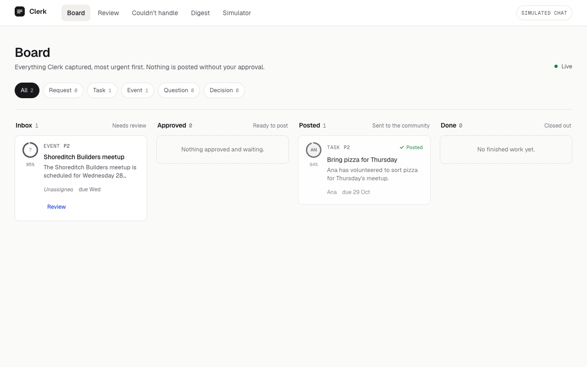
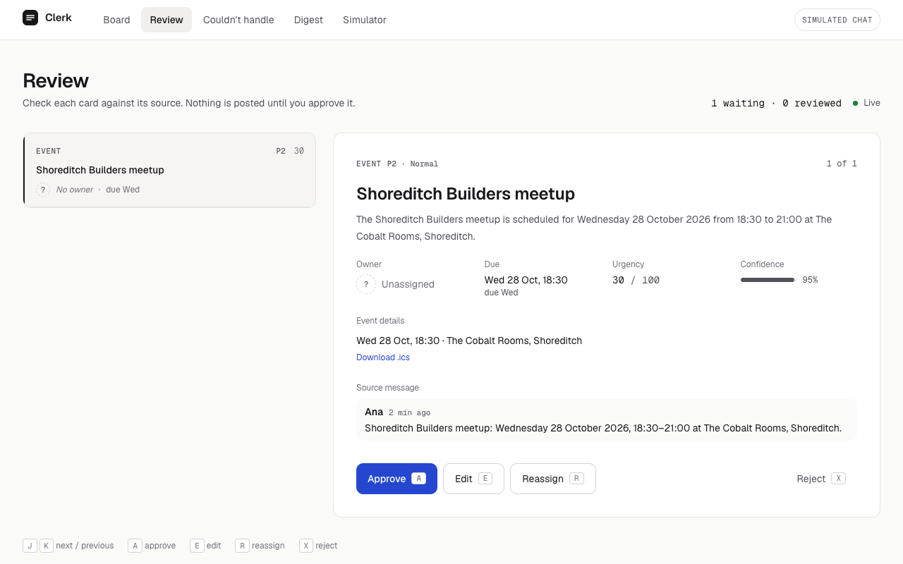
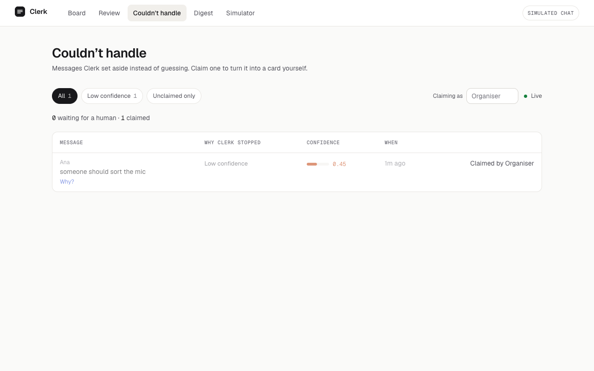
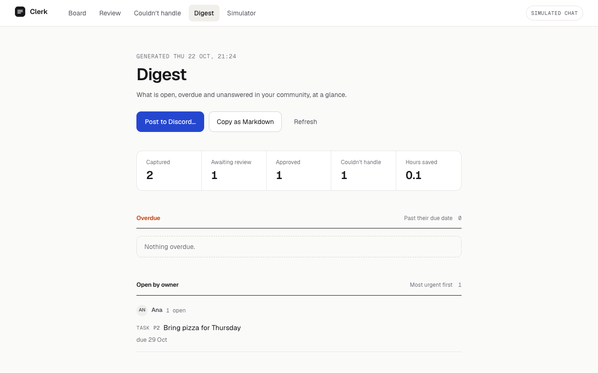
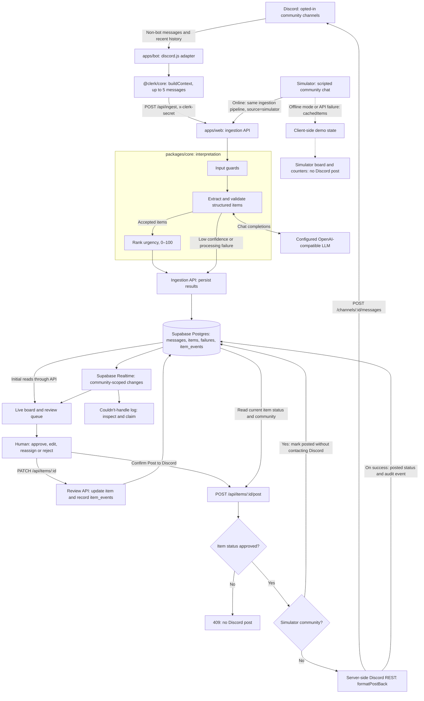

# Clerk

**Every message. Owned.**

Clerk is an open-source (MIT) Discord bot and web board that turns your community chat into tasks with an owner, a priority and a deadline — then puts a human in the loop before anything is posted. It also keeps an honest log of what it *couldn't* handle.

> Built for the Grok Bot Community Engineering London Hackathon, Track 5 "Front Desk & Revenue".

<!-- Screenshots: replace the placeholders below once the live build is deployed. -->
| Live board | Review queue |
|---|---|
|  |  |

| Couldn't-handle log | Digest |
|---|---|
|  |  |

---

## Why Clerk?

Community leads run events out of noisy chat. Venue requests, volunteer offers, sponsor leads and date changes get buried. Nobody knows who said they'd do what, questions go unanswered, and the "source of truth" is a pinned message or a Notion page that was last updated in March.

Clerk reads the chat (only in channels you opt in), and for every message it:

1. **Extracts** what is actionable — request, task, event, question, decision — or marks it as noise.
2. **Ranks** it with an urgency score from 0 to 100.
3. **Queues** it for review with the source message, thread context, owner, due date and a confidence score.
4. **Posts back** only after a human approves ("✅ Ana is on pizza, due Thu").
5. **Admits defeat** when it can't cope, in a visible log you can claim from.

**What you get**

- **Live board** — Inbox, Approved, Posted and Done columns, updating in realtime.
- **Review queue** — approve, edit, reassign or reject from the keyboard.
- **Couldn't-handle log** — low-confidence and unparseable messages, never silently dropped.
- **`/digest`** — open tasks by owner, overdue items, unanswered questions and this week's decisions.
- **Simulator** — try the whole thing with no Discord and no LLM key.

Nothing is ever posted publicly without human approval.

### How Clerk compares with what leads do today

| When you're… | What leads do today | What Clerk adds |
|---|---|---|
| Finding the next thing to act on | Scroll back through chat and judge urgency from memory | A queue ranked by priority, deadlines and urgency |
| Working out who volunteered | Search for “I'll do it” and piece together replies | Suggested owners alongside the source message; missing owners stay unassigned |
| Keeping a task board current | Copy messages into Notion or a spreadsheet by hand | Draft cards extracted from chat and queued for review |
| Telling the channel what's agreed | Write a separate confirmation after updating the board | A Discord post-back after human approval |
| Catching missed or unclear work | Rely on someone noticing that a message went unanswered | A couldn't-handle log with reasons, confidence where available and manual claiming |
| Preparing a community update | Rebuild the week's status from scattered messages | A digest of open work, overdue tasks, unanswered questions and recent decisions |

---

## Try it in two minutes (no Discord needed)

The simulator streams a scripted London meetup chat through the same pipeline as the real bot.

```bash
git clone https://github.com/aimmatrix/clerk.git
cd clerk
pnpm install
cp .env.example .env.local
# Offline demo: cached extractions, no LLM key, no network beyond localhost
echo "NEXT_PUBLIC_SIMULATOR_OFFLINE=1" >> .env.local
pnpm --filter web dev
```

Open <http://localhost:3000/simulator> and press **Play**. The simulator is clearly labelled *Clerk Demo Mode — simulated community chat* and is not Discord.

---

## Quickstart: run it for your community (~15 minutes)

**Prerequisites:** Node 20, [pnpm](https://pnpm.io/installation), a free [Supabase](https://supabase.com) project, a Discord server where you can add bots, and an API key for any OpenAI-compatible LLM provider.

### 1. Clone and install

```bash
git clone https://github.com/aimmatrix/clerk.git
cd clerk
pnpm install
cp .env.example .env.local
```

### 2. Set up Supabase (about 4 minutes)

1. Create a project at [supabase.com/dashboard](https://supabase.com/dashboard).
2. From **Project Settings → API**, copy these into `.env.local`:
   - `NEXT_PUBLIC_SUPABASE_URL` — the project URL
   - `NEXT_PUBLIC_SUPABASE_ANON_KEY` — the `anon` public key
   - `SUPABASE_SERVICE_ROLE_KEY` — the `service_role` key (**server-side only; never expose it in the browser or commit it**)
3. Apply the schema. Either run the files in `supabase/migrations/` (`0001_init.sql`, then `0002_views.sql`) in the SQL editor, or use the CLI:

   ```bash
   npx supabase link --project-ref <your-project-ref>
   npx supabase db push
   ```
4. Run `supabase/seed.sql` to create the demo community (`00000000-0000-0000-0000-000000000001`) so the simulator works.
5. Confirm realtime is on for `items`, `failures` and `messages` (the migration adds them to the `supabase_realtime` publication; check under **Database → Replication**).

### 3. Create the Discord app (about 5 minutes)

1. Go to the [Discord Developer Portal](https://discord.com/developers/applications) → **New Application**.
2. Copy the **Application ID** into `DISCORD_APP_ID`.
3. Open **Bot** → **Reset Token**, then copy the token into `DISCORD_BOT_TOKEN`. Treat it like a password.
4. On the same page, under **Privileged Gateway Intents**, switch on **Message Content Intent**. Without it the bot receives empty messages.
5. Open **OAuth2 → URL Generator**. Tick the scopes `bot` and `applications.commands`, and the permissions **View Channels**, **Read Message History**, **Send Messages**. Open the generated URL to invite the bot to your server.
6. In Discord, enable **Settings → Advanced → Developer Mode**, right-click your server and choose **Copy Server ID**. Put it in `DISCORD_GUILD_ID`.
7. Register your community so Clerk knows where to post approved items. Right-click the channel for post-backs → **Copy Channel ID**, then in the Supabase SQL editor:

   ```sql
   insert into communities (name, discord_guild_id, post_channel_id)
   values ('My Community', '<your guild id>', '<your channel id>');
   ```

Only add the bot to channels you are happy for Clerk to read. See [Privacy](#privacy).

### 4. Configure the LLM

Any OpenAI-compatible provider works. Set three variables in `.env.local`:

```bash
LLM_BASE_URL=https://api.openai.com/v1
LLM_API_KEY=sk-...
LLM_MODEL=gpt-4o-mini
```

See [Any LLM provider](#any-llm-provider) for other examples.

### 5. Set the remaining variables

```bash
CLERK_API_URL=http://localhost:3000
INGEST_SECRET=<any long random string, e.g. output of: openssl rand -hex 32>
DEMO_COMMUNITY_ID=00000000-0000-0000-0000-000000000001
CONFIDENCE_THRESHOLD=0.6
```

The full list lives in [`.env.example`](.env.example).

### 6. Run it

```bash
pnpm --filter web dev    # board, review queue, API, simulator at http://localhost:3000
pnpm --filter bot dev    # Discord bot (separate terminal)
```

Register the slash commands once (and again whenever they change):

```bash
pnpm --filter bot register-commands
```

### 7. Check it works

```bash
curl http://localhost:3000/api/health
# {"ok":true,"llm":true,"db":true}
```

Then post a message such as "I'll grab the pizza for Thursday" in a channel the bot can see. A card should appear on <http://localhost:3000/board> within a few seconds. Approve it in `/review` and Clerk posts the confirmation back to Discord.

Stuck? See [Troubleshooting](docs/troubleshooting.md).

---

## Any LLM provider

Clerk talks to `${LLM_BASE_URL}/chat/completions` using JSON-schema structured output, falling back to plain JSON mode for providers that don't support it. Anything that speaks the OpenAI chat-completions format will work:

| Provider | `LLM_BASE_URL` | Example `LLM_MODEL` |
|---|---|---|
| OpenAI | `https://api.openai.com/v1` | `gpt-4o-mini` |
| xAI (Grok) | `https://api.x.ai/v1` | check the provider's current model list |
| Self-hosted (Ollama) | `http://localhost:11434/v1` | `llama3.1` (any local model) |
| Other OpenAI-compatible gateway | your gateway's `/v1` URL | whatever it exposes |

Model names and endpoints change; check your provider's documentation. Smaller models are cheaper and quicker, but run the eval (below) before trusting one.

More detail in [docs/llm-providers.md](docs/llm-providers.md).

---

## Architecture



**Flow:** the bot (or the simulator) sends each message plus up to five messages of context to `/api/ingest`. The core library strips prompt-injection attempts, extracts items as strict JSON (one retry on invalid output), ranks them, and the API stores them in Supabase. Items below the confidence threshold, or with unparseable output, go to the failures log instead. Supabase Realtime pushes changes to the board. When a lead approves an item, the web app posts the confirmation to Discord through the REST API, so no bot HTTP server is needed.

```
apps/web/        Next.js 14 (App Router), Tailwind, shadcn/ui, Framer Motion
apps/bot/        discord.js v14
packages/core/   @clerk/core: types, extractor, ranker, context, digest, ICS
supabase/        migrations and seed
demo/seed/       simulator script and eval set
docs/            guides
```

The full walkthrough is in [docs/architecture.md](docs/architecture.md); deployment notes are in [docs/self-hosting.md](docs/self-hosting.md).

---

## Accuracy

Clerk ships with an evaluation set (60 labelled messages) and a scorer:

```bash
pnpm tsx demo/seed/eval/score.ts
```

It prints type accuracy, owner F1, priority within-one accuracy and a confusion matrix, and exits non-zero if type accuracy drops below 85%.

| Metric | Target | Latest result |
|---|---|---|
| Type accuracy | ≥ 85% | _not yet measured — run the scorer and paste the figure here_ |
| Owner F1 | ≥ 0.80 | _not yet measured_ |

Owners are only assigned when the person is named in the message or its context; otherwise the owner is left empty and the item is flagged as an ambiguous owner.

---

## Privacy

- **Opt-in channels.** Clerk only sees channels the bot has been given access to.
- **Self-hosted.** Messages are stored in *your* Supabase project. The only place message text is sent outside it is the LLM provider *you* configure.
- **No silent posting.** Clerk never posts publicly without human approval. `/digest` replies are ephemeral by default.
- **Secrets stay server-side.** The service-role key and Discord token are never exposed to the browser. Row-level security restricts each community's data to its owner; only the demo community is publicly readable.
- **Your members.** Tell your community that a bot is reading the channel and why. If you use a hosted LLM, check its data-retention terms.

---

## Run it for your community next week — checklist

- [ ] Pick one or two channels to start with (events, volunteers) and tell members the bot is there
- [ ] Complete the quickstart above and confirm `/api/health` is green
- [ ] Add the bot to just those channels
- [ ] Decide who the reviewers are and agree on a daily review slot
- [ ] Post a pinned message explaining what Clerk does and that nothing is posted without approval
- [ ] Run a week in "review only" mode, then check the couldn't-handle log for patterns
- [ ] Tune `CONFIDENCE_THRESHOLD` (raise it if there's too much noise, lower it if actions are being missed)
- [ ] Try `/digest` at the end of the week

---

## Status and known limitations

- The web app reads data through Supabase row-level security. The demo community is publicly readable so the simulator works logged-out; for your own community the board expects the viewer to be the community's `owner_user_id`. Check the current sign-in support in the web app before exposing a real community.
- Discord is the only supported chat platform for now.
- No auto-moderation, no DMs.

## Contributing

Contributions welcome. See [CONTRIBUTING.md](CONTRIBUTING.md).

## Licence

[MIT](LICENSE) © 2026 Clerk contributors.
