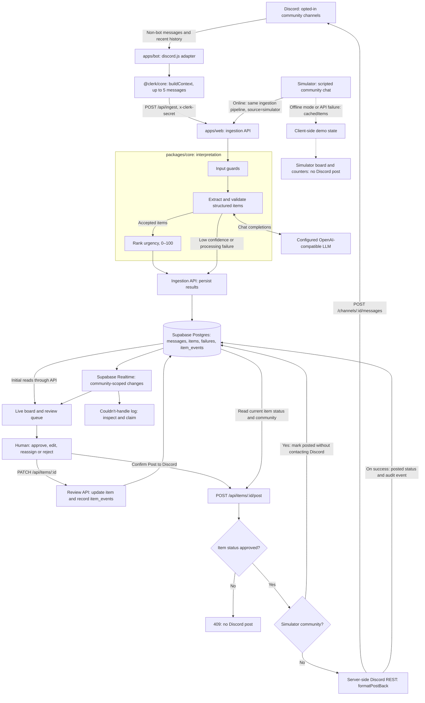

# Clerk architecture

Clerk separates capture, interpretation and publishing. Discord messages and the simulator feed the ingestion pipeline. The board shows the resulting items; a human reviews them before a server-side endpoint can post to Discord.

This diagram describes the Build Pack contract for integration, rather than a statement that every component has been deployed.

## Message to card

1. The bot skips bot messages and supplies recent channel or thread history to `buildContext`. The core helper selects up to five relevant messages, favouring the same thread, then reply links, then nearby channel messages.
2. The bot calls `POST /api/ingest` with the `x-clerk-secret` header. The API stores the source message and runs input guards, structured extraction and urgency ranking.
3. The extractor calls the configured LLM through the OpenAI-compatible chat-completions API. Structured output is validated, with one retry for invalid output. The default confidence threshold is `0.6`; uncertain or failed processing is recorded in `failures`. Noise stays out of the actionable board.
4. The API persists accepted items and audit events. Initial reads load the board; Supabase Realtime supplies subsequent community-scoped changes through `community:<id>:items`, `community:<id>:failures` and `community:<id>:messages`.

## Review to Discord

Review actions use `PATCH /api/items/:id` and record `item_events`. Approval and publication are separate API operations: after the reviewer confirms “Post to Discord?”, the UI calls `POST /api/items/:id/post`.

The post endpoint checks the stored status and returns `409` unless it is `approved`. It uses `formatPostBack` and the server-side bot token to call Discord REST directly; the bot needs no HTTP server. A successful post changes the item to `posted` and records a `posted` event. Editing, reassigning or rejecting an item does not itself publish a message.

The digest groups open work, overdue tasks, unanswered questions and recent decisions through `buildDigest`. Public digest posting also requires human approval. Event cards can expose an `.ics` download generated by `toIcs`.

## Simulator and offline fallback

The simulator reads `demo/seed/london-meetup.json`. Online, each step uses the same ingestion pipeline with `source='simulator'`. Its chat pane is labelled “Clerk Demo Mode — simulated community chat”.

With `NEXT_PUBLIC_SIMULATOR_OFFLINE=1`, or when the ingestion API fails, cached extractions populate client-side demo state. This fallback needs no Discord, Supabase connection or LLM call. Posting an approved simulator-community item through the server also skips Discord and only marks the item as posted.

## Data and credentials

Supabase holds communities, source messages, extracted items, failures and review events. Row-level security scopes community access; the designated demo community has public read access. The Supabase service-role key, ingestion secret and Discord bot token stay server-side. Live extraction sends message text and selected context to the LLM provider configured by the operator.
